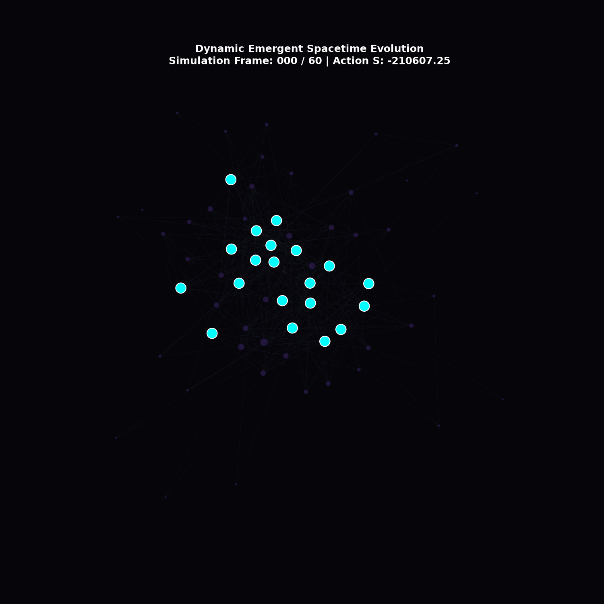

# Emergent Spacetime Manifold Simulation via Non-Commutative Network Geometry

This repository contains a numerical simulation exploring quantum gravity and non-commutative information routing. For the complete documentation, conceptual mechanics (Algebraic Substrate, Routing Engine, Metric Emergence), matter modeling as topological defects, and setup instructions, please refer to the project repository.
